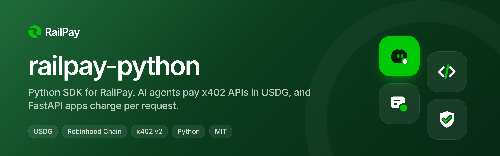

# railpay-python

Python SDK for [RailPay](https://railpay.app): stablecoin payments on Robinhood Chain.

`RailPay` is a typed client for the RailPay API: the agent's balance and policy, signed x402 payments (`pay()`), agent-to-agent transfers (`send()`) and network settings, with helpers for USDG units and base64 JSON headers.

Settlement is real: USDG (Global Dollar, 6 decimals) on Robinhood Chain (chain id 4663), using x402 v2, scheme `exact`, with EIP-3009 `TransferWithAuthorization`. This is the Python counterpart of the TypeScript SDK, [railpay-sdk](https://github.com/railpayapp/railpay-sdk), and speaks the same wire format.

## Install

The package is not on PyPI yet. Install it from GitHub:

```sh
pip install git+https://github.com/railpayapp/railpay-python
# uv:
uv add git+https://github.com/railpayapp/railpay-python
```

Python 3.10+. The one runtime dependency is [httpx](https://www.python-httpx.org). Fully typed (`py.typed`).

## Use

Create an agent in the [RailPay dapp](https://dapp.railpay.app), set its policy (per-request max, daily cap, allowed hosts, allowed recipients), fund its wallet with USDG and create an agent key (`rp_sk_…`).

```python
import os

import httpx

from railpay import RailPay, from_units, unb64json

with RailPay(os.environ["RAILPAY_AGENT_KEY"]) as railpay:
    agent = railpay.me()
    print(agent["address"], from_units(agent["balance"]), "USDG")

    # Pay an x402 resource by hand: read the 402, let RailPay sign, retry.
    url = "https://dapp.railpay.app/x402/time"
    first = httpx.get(url)  # 402 with a PAYMENT-REQUIRED header
    signed = railpay.pay(unb64json(first.headers["payment-required"]), url)
    res = httpx.get(url, headers={signed["header"]: signed["payment"]})
```

RailPay checks the agent's policy before it signs the EIP-3009 authorization. The agent key goes only to RailPay, never to the seller.

## API

### `RailPay(api_key=None, *, base_url="https://dapp.railpay.app", http_client=None, timeout=30.0)`

It closes its own HTTP client (`close()`, or use it as a context manager), never one you passed in.

| Method | Auth | Returns |
|---|---|---|
| `me()` | agent key | the agent: address, USDG `balance` (base units), `eth`, `spent_today`, `policy` |
| `pay(payment_required, resource_url=None)` | agent key | `{payment, header, authorization, valid_before, amount, spent_today}` |
| `send(to, amount, memo=None)` | agent key | agent-to-agent payment `{tx_hash, tx_url, amount}`. `amount` is USDG (`"0.5"` or `Decimal`). Needs `allow_a2a`, and the paying agent wallet pays the gas in ETH |
| `config()` | public | network, USDG, facilitators, relayer status |
| `stats()` | account key | network stats for signed-in accounts: every recorded payment, outside vs team |
| `request(method, path, body=None)` | | any other endpoint |

API errors raise `RailPayError` with `status`, `code` and `message`. Policy refusals are `403` with code `paused`, `over_per_request`, `over_daily_cap`, `host_not_allowed`, `pay_to_not_allowed`, `a2a_not_allowed`, `insufficient_funds` or `insufficient_gas`, and each one is logged on the agent in the dapp. Local refusals have `status` 0 (`missing_api_key`).

### Helpers

- `to_units("1.5")` → `1500000`, `from_units(1500000)` → `"1.5"`
- `b64json(value)`, `unb64json(string)`
- Constants: `CHAIN_ID`, `NETWORK`, `USDG`, `USDG_DECIMALS`, `USDG_EIP712`, `DEFAULT_FACILITATORS`, `MIN_X402_AMOUNT`, `EXPLORER`, `tx_url(hash)`, `address_url(address)`

## Security

- An agent key can spend from the agent wallet within its policy. Keep it on a server, never in client-side code. Set a daily cap and allowlists in the dapp.
- Report vulnerabilities to founder@railpay.app (see [SECURITY.md](SECURITY.md)).

## Development

```sh
uv sync
uv run ruff check . && uv run ruff format --check . && uv run mypy && uv run pytest
```

Tests mock HTTP. Nothing touches the network.

## Links

- Website: https://railpay.app
- Docs: https://docs.railpay.app
- Dapp: https://dapp.railpay.app
- TypeScript SDK: https://github.com/railpayapp/railpay-sdk
- MCP server: https://github.com/railpayapp/railpay-mcp
- X: https://x.com/railpayapp

## License

[MIT](LICENSE)
